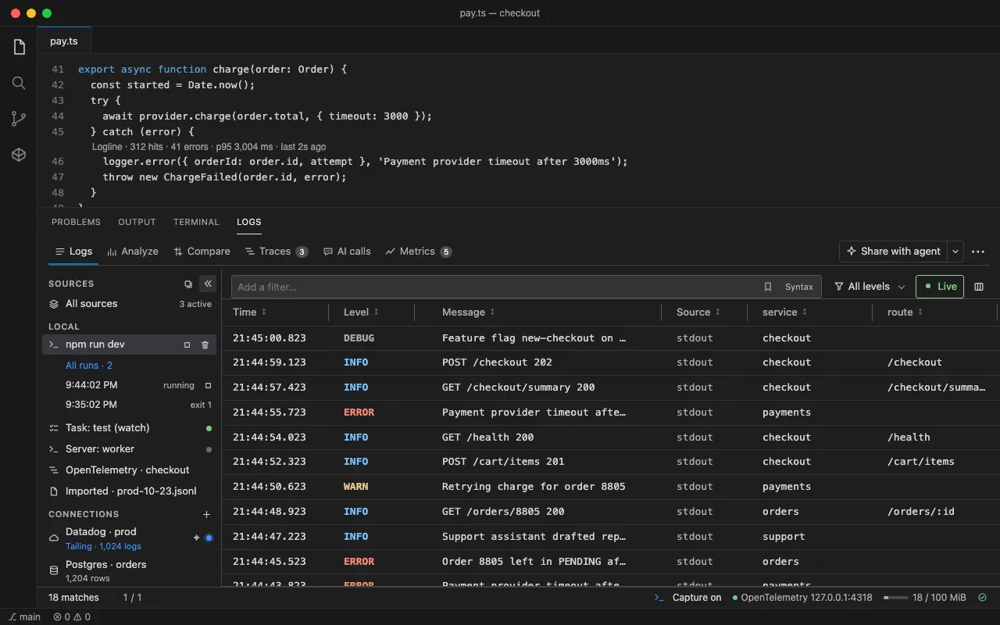
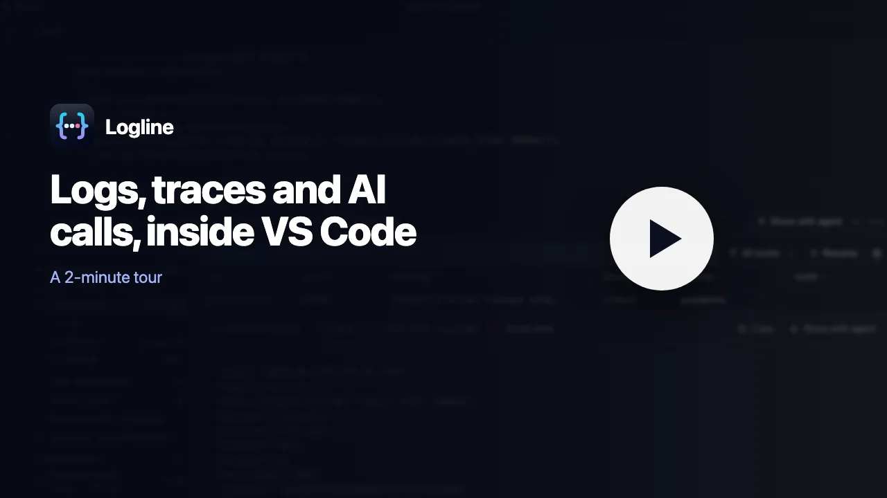
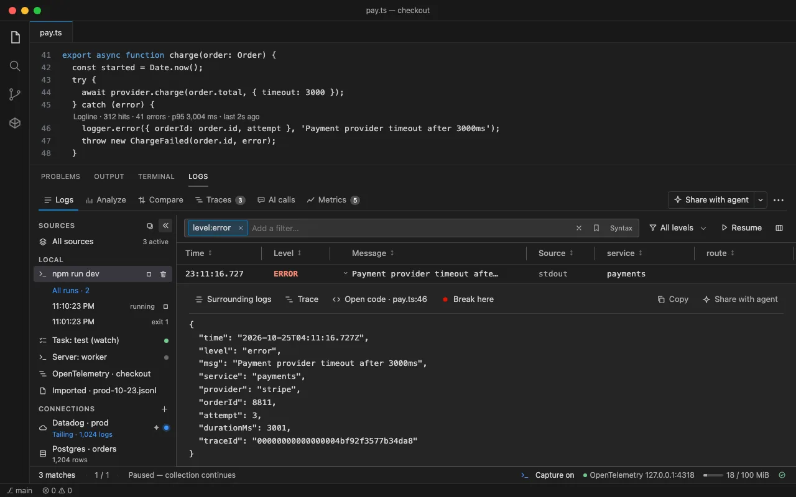
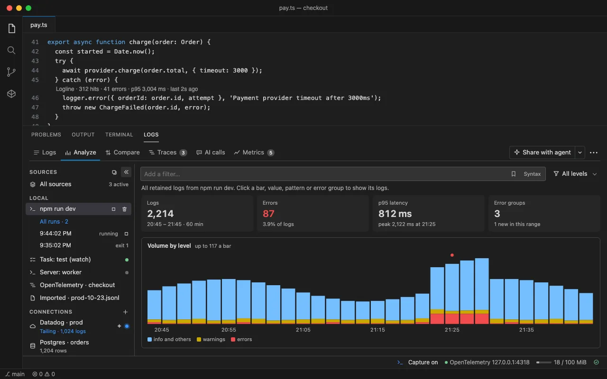
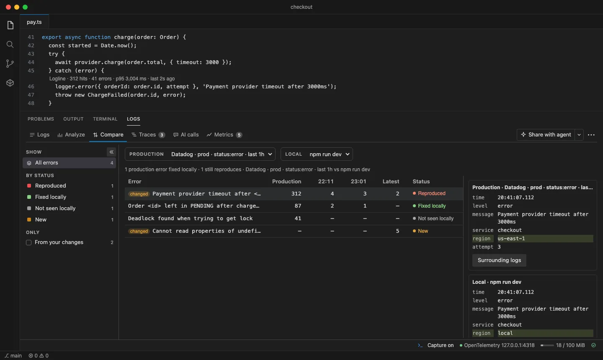
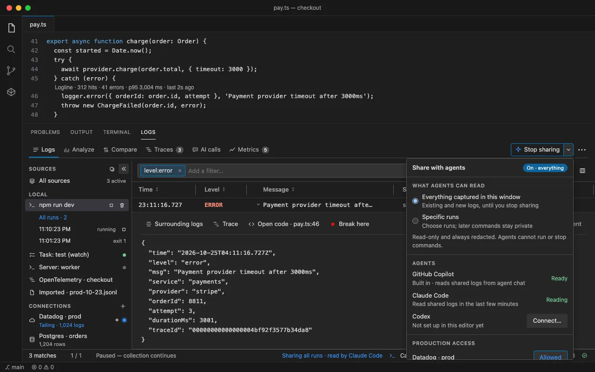

# Logline

**Your app's logs, traces, and LLM calls, live inside VS Code, and ready for your AI agent.**

Run your app the way you already do: in a terminal, with F5, as a task, in Docker Compose, or instrumented with OpenTelemetry. Logline puts everything it says in one searchable panel next to your code, lines production logs up with your local run, and lets Copilot, Claude Code, or Codex read it all, redacted.

<!-- When the tour video is published, add its thumbnail here, linked to the video:
 -->

## See what your app is doing

- **Capture anything**: terminals, F5 debug sessions in any language, tasks, log files, Docker Compose and Kubernetes services, and OpenTelemetry logs, traces, and metrics, with no collector.
- **Search like you think**: `level:error service:api`, `status:5xx`, `durationMs:>200`, `last:15m`, or `changed:true` for logs from code you changed since the last commit.
- **Read any format**: JSON, logfmt, plain text, Pino, Winston, Log4j2, and ECS, with stack traces kept together.
- **Back to the code**: every log statement shows live hit counts, errors, and p95 durations above it, and **Break here** stops the debugger the next time it logs.

## Find the problem

- **Analyze** shows error rate and latency over time, error groups, status codes, and the patterns behind the noise. Click anything to see its logs.
- **Traces** follow one request across services in a waterfall, with its logs on the spans.
- **AI calls** list every LLM call your app makes, from OpenTelemetry GenAI spans: model, tokens, cache share, latency, and the full conversation with each tool call.
- **Log doctor** flags statements that log secrets or personal data, swallow exceptions, or are too noisy, with quick fixes.

## Debug production next to local

- **Connections** search and tail Datadog, Postgres, MySQL and Aurora (with AWS IAM sign-in), MongoDB, and SQLite logs, read-only, beside your local runs.
- **Compare** lines production errors up with your newest local runs: is it reproduced, and is your fix working? Errors from code you changed are tagged.
- **Metrics** chart a connection's queries; drag across a spike to fetch the logs from that window.

## Hand it to your agent

**Share with agent** gives Copilot, Claude Code, Codex, or the agent in Cursor, Windsurf, or Kiro read-only access to what you choose: everything, or specific runs. Logs are always redacted, agents can't run anything, and **Stop sharing** cuts them off at once. Allow an agent to fetch from a connection, and it can pull production logs and compare them with your run, then verify its own fix.

## Get started

1. Install Logline in **VS Code 1.99+** from the [Marketplace](https://marketplace.visualstudio.com/items?itemName=surjeetbanga.logline). In Cursor, Windsurf, or Kiro, install it from [Open VSX](https://open-vsx.org/extension/surjeetbanga/logline).
2. Open the **Logs** panel. Click **Capture off** in its status bar so it reads **Capture on**, then run your app in a terminal as usual. Or press F5: debug output appears automatically.
3. Type `level:error` in the search box and press **Enter**. Click an event to see everything about it.

New to it? Logline offers a one-minute tour the first time, and **More actions → Help** opens the guide. To try it without your own app, import [samples/demo-logs.jsonl](samples/demo-logs.jsonl) with **Logline: Import Logs**, or run the [checkout sample](samples/README.md#checkout-demo).

## Everything else

| | |
| --- | --- |
| **Save and run servers** | Save commands with **Manage servers**, start them with the workspace, and convert VS Code tasks to captured ones. |
| **Search tools** | Field and value autocomplete, include or exclude a value from any cell, saved searches, and surrounding logs from the same run. |
| **Export** | JSONL, JSON, CSV, or Markdown for AI tools, redacted by default. |
| **Retention** | Keeps the newest logs within a memory budget you set, optionally written to disk. |
| **Troubleshooting** | **Logline: Show Status** shows what is on, off, or broken, with the fix. |

Logline keeps everything on your machine. Nothing leaves it unless you share it with an agent or query a connection you added.

## Learn more

- [Usage reference](docs/usage.md): every feature, setting, and query.
- [Changelog](CHANGELOG.md): what changed in each release.
- [Contributing](CONTRIBUTING.md) and [architecture](ARCHITECTURE.md): build, test, and send a pull request.

## License

[MIT](LICENSE)
